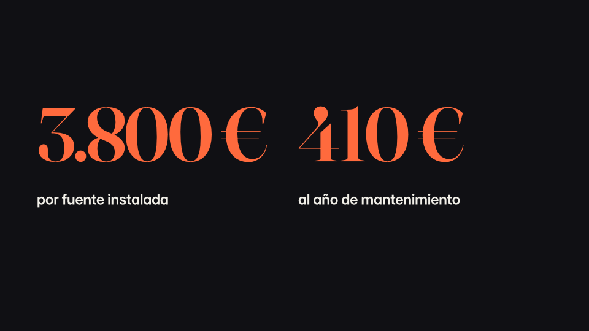
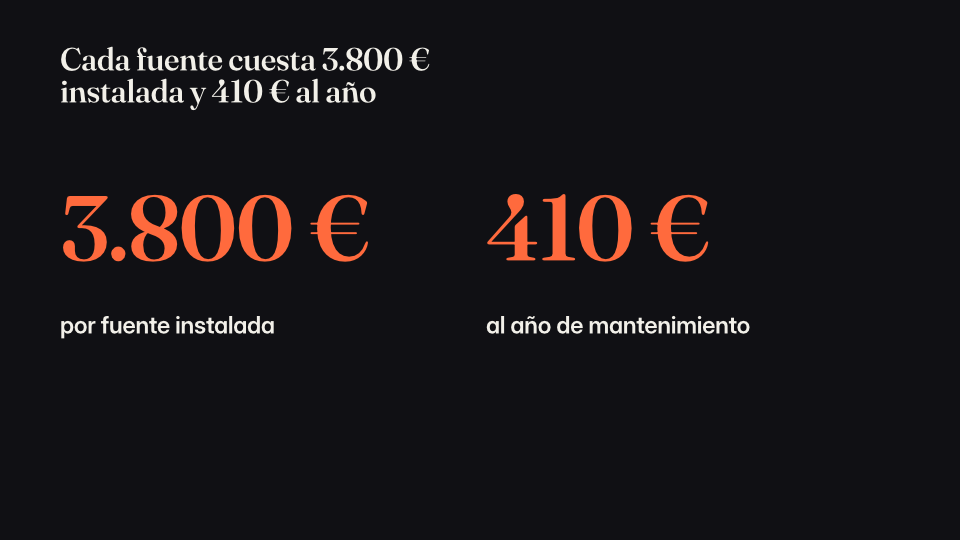

# Agent dogfood 12: a Spanish pitch from a PDF and a CSV, over MCP

Run on main at 0fc1c7c3, after #1283 landed (deck format 0.41). The deck is a pitch to Seville's
city council, *Ampliar la red de fuentes de agua potable de 12 a 120*. It was made with MCP
alone: one `deck_generate`, then `deck_health`, `deck_patch`, `deck_lint`, `deck_render` and
`deck_export` with notes. No model was called and `deck.json` was never edited by hand.

The inputs, the answer key and the calls are kept beside this report:
- `informe.pdf`: the heat report, one page of prose;
- `piloto.csv`: the pilot's months;
- `PLAN.md`: which source holds each figure;
- `calls.jsonl`.

**Open PRs matched:** none. No finding touches #1132 (h: code as one idea) or #1143 (i: length
from minutes outside the op). #1278's path works over MCP: a `brief` op of 20 minutes with
`length: null` wrote `11-15 slides`, and 12 minutes wrote `5-10 slides`.

**Score:** 86 as made (pacing 100, balance 86, fidelity 75). In a Spanish deck coherence,
intensity and tone go unscored, by design. No finding below moves it.

## What works

- **Both sources keep their figures.** The PDF's come through #1266's reader, and the CSV's are
  read cell by cell. The sums, 66.400 litres and 132.800 bottles, are kept by neither, and raise
  no finding.
- **The wrong-source check fires where it should.**
  - On the deck as made: slides 4 and 5 write "12" (fountains) and cite `piloto.csv`, but the
    report holds it. Both are right.
  - Planted: slide 6's beat cited to `piloto.csv` gives "Slide 6 writes 3.800 € and cites
    piloto.csv, which does not hold it; informe.pdf does." Its fix clears it.
- **PDF export with notes** puts each slide's notes under it, in Spanish, as written.

## Findings, ranked

### 1. Sourcing reads every figure with English marks (both sides)

`scaena_narrato::figures`, which reads both what a source keeps (`source_figures`) and a slide's
figure in the check (`holds`), treats `.` as the decimal point and `,` as the thousands mark.
In a Spanish source that gets numbers wrong:

| written | read as |
|---|---|
| 3.800 € | 3.8 |
| 46,2 °C | 462 |

- **When both sides are in Spanish**, the misreadings match each other, so the check gives the
  right answer by luck. That is why slide 6's 3.800 € was caught.
- **When a slide is in Spanish and the source is a sheet**, the check breaks. A CSV cell is
  written plainly, `18400`, while the slide writes "18.400" and is read as 18.4.
  - **False negative.** A Spanish slide writes July's "18.400 litros", which only
    `piloto.csv` holds, and its beat cites the report alone. No finding: the slide's 18.400 is
    read as 18.4, which neither source holds. In this run, slide 4 cited to the report alone gave
    no finding for another reason, a right one: its chart's note names `piloto.csv`, which the
    check counts as citing it. The fix's test writes the figure on slide 5, which names no sheet.
  - **Missed in the other direction.** An English report's "€3,800" is kept as 3800. A Spanish
    slide's "3.800 €" is read as 3.8, so a slide citing the sheet for it isn't caught.
- **Where else.** It applies to every deck whose language groups with `.` or decimals with
  `,`: German, French, Italian, Portuguese, Spanish. The builder already reads a figure in the
  deck's own marks (`narrative::marked`, dogfood pass 10). Health's figure check doesn't.

**Built** (the coordinator's notes):
- A slide's figures are read in the deck's marks.
- A source's prose is read in its own marks, where its figures tell them
  (`scaena_narrato::decimal_mark`: "46,2" and "1.234,5" tell a comma, "25.8" and "1,234.5" a
  point, "3.800" alone nothing), else in the deck's.
- A sheet's cells are read in the sheet's own marks, else as written plainly.
- `source` findings feed no measure, so no score moves.

### 2. Spanish months are charted longest first

Slide 4's bars run julio, agosto, septiembre, junio, mayo. The chart did bind to the CSV's date
column, and lights July (`highlight` at `2025-07-01`), but it kept `sort: -litros_servidos`.
That sort was chosen from the slide's own categories, "Mayo" to "Septiembre", which the builder
does not know as months. Longest first is for names with no order of their own, so a time series
is drawn out of order.

**Proposal.**
- Read month names in the deck's language as ordered.
- Never sort a chart that binding has bound to a date column.

### 3. The claim that heads a bare close is not typeset

The closing's headline (`gracias-statement`) is the ask's claim with a plain space before "€",
so it breaks "460.000 / €" across lines. The same claim keeps its no-break space everywhere
else: in the spine, on slide 7's headline, and on its second card.

**Proposal.** Take the heading from the claim as typeset, or run it through the typesetter.

### 4. W305 on the Takeaways numbers, which say the right thing

Slide 7 asked for "Call to Action" with three items. It took Takeaways, whose number places
start as "1", "2", "3". The builder leaves them as they are, and those are the right numbers.
Lint gives W305 three times, which is noise on a made deck.

**Proposal**, either of:
- the builder writes each number as the slide's own;
- W305 lets a numbered place pass when its prompt is its own position.

### 5. The closing gets the ask's claim, so two beats make one claim

The bare close is headed with its beat's settled claim (W1 dogfood 8). The builder gave it a beat
of its own carrying that same claim. Lint W425 and a health `story` warning on slide 8 both say
two beats make the same claim, and the deck's own rule caused it.

This is not score-moving here, since coherence goes unscored in Spanish. In an English deck the
`story` finding may move a score, so I'll measure before building.

**Proposal.** The close joins its claim's beat, or keeps no claim of its own.

### 6. "Las 12 fuentes" read as a count

Health says: "Slide 5's headline counts twelve, and the slide lists three." `cuenta` reads a
number from 2 to 12 before a noun as the count of what the slide lists. "Las 12 fuentes" names a
known set: the 12 pilot fountains.

**Proposal.** A number after a definite article (las, los, el, la; "the" in English) names a set,
and counts nothing.

### 7. Smaller

- **"Two Numbers" fell to a bullet list** (slide 6). Two items, each led by its figure, could
  take `two-figures`, as three and four take Numbers and Four Numbers.
- **Only a slide's first misattributed figure is reported.** Slide 5's "18 %" is the report's,
  cited to the sheet, and is hidden behind its "12". This is by design in #1283. Fixing the
  first would bring up the next.
- **The ask's 460.000 € "cites neither source."** That is the older unsourced-figure warning,
  not #1283's. A figure on an ask slide that no source holds is the talk's own, as #1283 already
  treats one.

## What I'd build

- 1, 2 and 3, as one draft PR each, no score moving, each with a test that fails without it.
- 4 and 6 as small PRs.
- 5 after I measure it on the English calibration decks.

## A note on the shared build folder

My first run's deck failed validation with E106, its format 0.41 refused as past 0.40. The
binary had embedded another worktree's schemas from the build folder they share, and a clean
rebuild of the crates cleared it. #1269 makes the script read its folder at run time, but a
target shared across worktrees can still hand one worktree's schemas to another. No change.

## Slide 6, set as two figures (the re-measure's C)

Slide 6 says two costs, "3.800 € por fuente instalada" and "410 € al año de mantenimiento", under
the claim "Cada fuente cuesta 3.800 € instalada y 410 € al año". It took Two Numbers, which has no
place for a headline, so the claim was dropped from the slide. Two points each led by its figure
now take Two Figures, the claim over them and both figures in the accent, as Two Numbers drew
them. Only two bars' figures set the one the slide is not about back.

| Before (Two Numbers) | After (Two Figures) |
| --- | --- |
|  |  |
