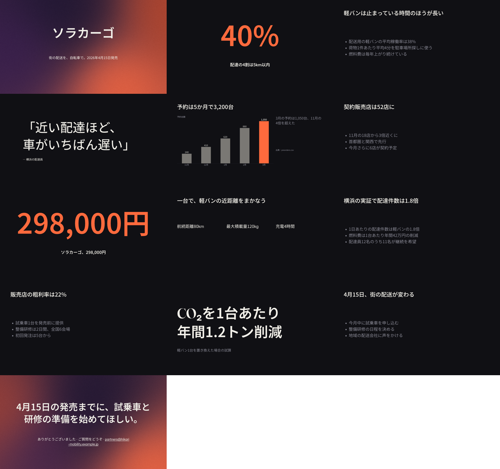

# Dogfood 20: a Japanese product launch, made and worked in the browser's editor

This dogfood made a 20-minute talk in Japanese with From a prompt…. It was grounded in a PowerPoint brief (words only) and a CSV, against a scripted Anthropic, as editor dogfood 8 scripts its provider. A person then worked the deck in the editor:
- the Story's findings, by its own buttons and by the assistant;
- a headline typed over on the canvas through an input method's composition (kana composed, converted, committed);
- a rehearsal against the brief's 20-minute slot;
- Export… a PDF with notes.

Japanese is the script dogfooded least, and the editor the least path of all.

It was walked in headless Chromium, the CPU painting, built as `just web` builds it:
- first at main `b6e244eb` (the trial);
- then at main `01c66bfe`, once the five fixes below had landed (the run this records).

## How it was run

```
python3 docs/examples/dogfood-20/brief.py      # writes brief.pptx
node docs/examples/dogfood-20/walk.mjs [OUTDIR] [STAGES]   # make,bundle,probe,story,ime,rehearse,export
```

**The sources.**
- `brief.pptx` (python-pptx) is Hikari Mobility's product brief for the Sora Cargo, an electric cargo trike, in six slides of words. It has:
  - the market: 40% of city deliveries within 5 km; delivery vans at 38% use;
  - the price, 298,000円, with 80 km of range, 120 kg of payload, and 4 hours to charge;
  - the Yokohama trial: 1.8 times the deliveries, and 42万円 a year saved;
  - preorders: 3,200 by March, from 52 dealers;
  - the dealers' terms: a 22% margin.
- `preorders.csv` is preorders and dealers by month, `2025-11` to `2026-03`, 3,200 in all.

**The brief.**
- **Topic:** ソラカーゴ発売：街の配送を車から自転車へ.
- **Audience:** 全国の販売店パートナー.
- **Goal and length:** Persuade, 20 minutes, in Japanese, with the outline shown.
- **Big idea:** ソラカーゴは、街の配送を車から自転車へ移す最初の一台になる。

**The scripted provider** answers each call:
- **The arc:** The Reveal.
- **The outline:** six beats, 13 slides against the 11–15 a 20-minute brief takes.
- **The slides**, drafted in Japanese as a model writes them:
  - a quote and who said it in one point;
  - a Big Number of 298,000円;
  - a bar chart of preorders by month, written 11月 to 3月;
  - three specs in columns;
  - a CO₂ figure no source holds;
  - a bare close: ありがとうございました / ご質問をどうぞ, and an address.
- **The look:** no changes.
- **The notes:** to the characters each slide is asked for.
- **The assistant:** reads the deck and patches only what an English ask names.

Noto Sans JP is served from the CLI's cache, held by its SHA-256, so the walk asks nothing of the network.



## Findings, worst first

Each finding has its own pull request off main. Five landed before the run this records; three more came from that run.

1. **An answer that changed nothing took a slide's error off the Story, and said it had answered it (#1338, landed).**
   - **What happened:** the close carried an E101, and the Story led with it, its score capped at 82. The assistant was asked about it and changed nothing. The Story then dropped the error, the score rose to 89, and the status said "Answers 1 of the Story's findings: slide 13's layout". The editor still held the E101.
   - **Cause:** once an assistant's turn ends, the page compiles the deck's source again, the same text. `Session::compile` reset what the last lint found to validation's alone, and the Story reads beside those findings.
   - **Fix:** the same source, from the same files in the same theme, keeps them.
   - **Confirmed:** the probe stage (`probe`) reads the Story's errors against the editor's at five points. After the fix they agree throughout.
2. **A Japanese claim stood five letters a line, shrank to half its size, and ran over the thanks under it (#1341, landed).**
   - **What happened:** the bare close was headed by its beat's settled claim, 4月15日の発売までに、試乗車と研修の準備を始めてほしい。. It set in five lines where the display role's `maxLines` is 3, and shrank to its floor (W202, W203). It then overlapped the thanks: E101, the error that capped the story.
   - **Cause:** a role's `measure` counted `ch`, the advance of `0`. A kana or a kanji is an em, about two zeros, so the display role's 16 characters held about eight. The measure scales with the size, so shrinking bought no line back.
   - **Fix:** a text in Japanese, Chinese, or Korean counts its measure in `ic`, an em, as CSS does. The close now sets in two lines, and the made deck lints clean.
   - **The coordinator's call,** listed to Jay as one he may veto.
3. **The chart's months did not bind, so a data edit would not draw it again (#1343, landed; #1356).**
   - **Months:** 11月 to 3月 matched no locale's month names. #1343 reads a month written by its number and counter, 月 or 월, with a year or none (2025年11月). The axis prints it as written (`%-m月`).
   - **The series:** with its months bound, the chart still kept its own rows. Its series "予約台数" shares no words with the columns `preorders` and `dealers`. #1356 binds a series named in a script with no Latin letters to the one number column whose cells are its figures, exactly. A series named in Latin letters that names no column is still asked to name one.
4. **A quote and who said it, in one point, set a stray 」 after the name (#1345, landed).**
   - **What happened:** 「近い配達ほど、車がいちばん遅い」 — 横浜の配達員 was set as one quote: 「…遅い」 — 横浜の配達員」.
   - **Fix:** corner brackets now mark words as English marks do, and a dash after them signs them, spaced or not.
5. **298,000円 split, and then lost its meaning (#1346, landed; #1355).**
   - **What happened:** the Big Number set "298,000" over "円 税込、標準バッテリー込み".
   - **#1346** keeps a currency written straight after its figure in the figure; a counter such as 台 stays outside.
   - **Its regression:** on main the meaning then went. "税込、標準バッテリー込み" is one word by whitespace, so `led` found no words run on from the figure, and the claim slot took the slide's title. Its test had checked only the figure.
   - **#1355** counts a script set without spaces by its letters there, and its test now holds the meaning.
6. **The download is named ソラカーコ (#1357).**
   - **What happened:** the worker's `nameFor` decomposes a title (NFKD) and keeps letters and digits. ゴ's voicing mark (U+3099) is neither, so it went. The same rule cut パンとバター to "ハ-ンとハ-ター" and left a Korean name in decomposed jamo.
   - **Fix:** `web/src/named.ts` keeps each letter's marks, takes off a Latin letter's accent alone, and composes the word again. `web/named.mjs` checks it in `just scripts` and CI.
7. **Language is folded under More (to do, the coordinator's call).**
   - **What happened:** a person writing a Japanese brief finds Language under More, set to English. The walk opens More to choose it.
   - **Next:** From a prompt… will take the language from the brief's own script where none is chosen (`scaena_ops::scripts::written_in` tells them apart), and show the choice beside the brief. The browser comes first, then the Mac and the iPad where the path is the same. It is its own pull request.

## By design, recorded

- **Health reads little of a Japanese deck.** Coherence, intensity, and tone have no score, and the claims and the big idea are not checked. Each says so in Japanese's terms: "health reads words a space sets apart, and this deck is in Japanese". The arc is read from the plans (71: the scripted slides all plan 0.50). Pacing reads the notes at 300 characters a minute: "About 20 minutes of talk, where its brief asks 20 minutes."
- **A CO₂ figure no source holds** (CO₂を1台あたり年間1.2トン削減, cited to `brief.pptx`) draws no finding. #1302 finds such a figure in English decks alone.
- **The scripted assistant answers no Japanese health ask.** Its asks are English sentences about a Japanese deck. A real model would answer them; the script patches only what an English ask names. So the Story's four infos and its warning (the close's address, which neither the brief nor the sources name) stood as made.

## What held

- **Made from the PowerPoint and the CSV in the browser.**
  - The page fetched Noto Sans JP (9.6 MB) before any call. It read `brief.pptx` (slides) and `preorders.csv`, and settled the outline: 13 slides against 11–15.
  - It then wrote the slides, the look (two rounds), and the notes. The status said "Made: 13 slides on the arc The Reveal … story 88 of 100 — No issues".
  - The deck keeps each source's figures: `brief.pptx` 19 of them, `preorders.csv` 12 with the column's total, 3,200 (#1334).
  - `scaena lint` on the downloaded bundle: "ok: no findings".
- **Japanese typesetting.**
  - Phrases are kept whole, and figures are set in the script's face.
  - Quotes stand in 「」, and CO₂ keeps its subscript.
  - The display role's claim sets on two lines (after #1341).
- **Typing through an input method on the canvas.** A double click on slide 12's headline typed in it, saying "what is typed shows on 3 steps of Slide 12". 、い and 、いま were composed in place with the caret after them, converted to 、今, and committed. The source holds 「4月15日、街の配送が変わる、今」 and no kana of the composition. One undo gives the headline back.
- **Rehearse.** "1:32 taken against a 19:41 plan, for a 20-minute slot: −18:08", each slide and step against its plan, and Keep these timings offered. Its notes pane shows the slide's Japanese notes, and the next slide's name.
- **Export… a PDF with notes.**
  - Before it is made, the dialog says what the PDF holds.
  - The PDF has 13 pages, each slide drawn smaller with its notes under it, in Japanese that copies as written (`pdftotext`).
  - The notes break between phrases. One break falls inside お集まり, where kana gives way to Han, as the phrase rule reads it.
- **The bundle downloaded** with its fonts cut to what it draws: 11,213 KB to 4,689 KB.
